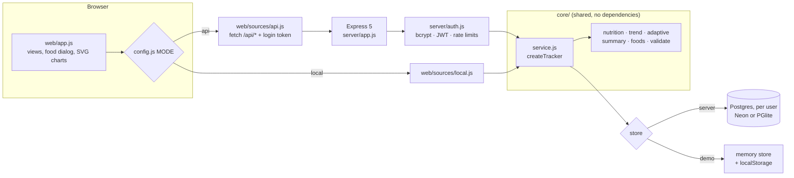

# Steady: weight and calorie tracker

Type what you ate the way you'd say it, like "1 bowl white rice", "150g chicken breast" or "2 eggs", and Steady logs the exact grams and calories. Add your morning weigh-ins and it gives you a daily calorie target. Most trackers take that target from a formula and never change it. Steady checks it against your own results: after a few weeks of logging it measures how many calories you really burn, using what you ate and how your weight moved, and adjusts the target to match.

Steady runs in two ways, from the same code:

- **Online app with an account:** https://calorie-weight-tracker.vercel.app (Vercel + Neon Postgres). Log in on your phone and your laptop and see the same data on both.
- **Browser demo, no account:** https://ethanyap123.github.io/calorie-weight-tracker/ runs the same tracker code in your browser and saves to `localStorage` on that device only. **Try it with sample data:** https://ethanyap123.github.io/calorie-weight-tracker/?demo

On a phone, use "Add to Home Screen" to install either one as an app. See [Deployment](#deployment).

   [](https://github.com/EthanYap123/calorie-weight-tracker/actions/workflows/ci.yml)

## Features

- **Type it like you say it.** "1 bowl white rice", "100g white rice", "half a plate of chicken rice", "2 eggs", "300ml milk" or "chicken rice x2" are all understood. Before you add an entry, Steady shows the grams and calories it will log, and Enter adds the top match.
- **Measured in grams.** 242 built-in foods store nutrition per 100 g, with portions that have real weights (1 bowl of rice = 200 g, 1 large egg = 50 g, 1 glass of milk = 250 ml = 258 g). Pick any portion or switch to grams and the numbers update live. "1 bowl white rice" and "200g white rice" log the same 260 kcal.
- **Sourced values.** 124 generic foods (rice, eggs, meat, fish, beans, fruit, vegetables, milk, nuts, oils) come from USDA FoodData Central. 117 hawker, dim sum, restaurant and kopitiam items are typical portions, marked as estimates in the app, and you can log them by weight instead.
- **Anything else, online.** When a food isn't built in, Steady searches [USDA FoodData Central](https://fdc.nal.usda.gov) (about 400,000 foods: everyday dishes, ingredients and branded US products) and [Open Food Facts](https://world.openfoodfacts.org) (millions of product labels, including Singapore brands like Marigold and Gardenia). Results are merged and ranked by how many of your words match. Picking a USDA food loads its household portions (1 cup of baked beans = 254 g), so amounts stay in real grams. Type or scan a barcode for an exact product. Anything found online can be saved to My foods.
- **Forgiving search.** One typo per word is fine ("chiken rice", "laska", "ebans"), and ounces and pounds convert to grams.
- **My foods.** Save a packaged food from its nutrition label, per 100 g or per serving. It's stored per 100 g and then searchable like any other food ("2 packets hl milk").
- **Quick add.** Enter known calories for a one-off restaurant meal.
- **Faster logging.** One-tap **Recent foods**, **copy yesterday's meal**, and tap any entry to change its amount or move it to another meal.
- **Water.** A daily goal with +250 ml and +500 ml buttons.
- **Exercise and steps.** Pick from 26 activities (walking, running, gym, badminton, swimming…) and enter minutes, or enter steps. Calories burned use MET values from the Compendium of Physical Activities and your weight, counting only the energy above resting. You choose whether exercise adds to your daily target.
- **Sleep and mood.** A quick daily check-in: hours slept, sleep quality 1–5, mood 1–5 and an optional note.
- **Weekly report.** The last 7 days against the 7 before: average calories and protein, days logged and on target, weight change, workouts, exercise calories, steps, water, sleep, mood and fasts.
- **Charts.** Weight trend, 14-day calories, and 4-week charts for water, exercise, sleep and mood, plus waist size over time.
- **Reminders.** Set times for weigh-in, meals and water. Steady adds them to your phone's calendar as daily repeating events with alerts, so they fire even when the app is closed. It also shows nudges on the Today screen ("Nothing logged for lunch yet") and notifications while the app is open. A web app can't schedule its own alerts without a push server, so the calendar does that part.
- **Body tab.** BMI with Singapore's Asian cut-offs (healthy 18.5–22.9) and WHO's, your healthy weight range, tape measurements (waist, neck, hips), body fat by the US Navy method, and waist-to-height ratio.
- **Tools tab.** Calculators for BMI, calories needed (BMR, maintenance, lose and gain), body fat, protein and water. They work for any numbers, not just yours. There's also an intermittent fasting timer (16:8 or your own goal) with history.
- **Daily target and macros.** A ring shows calories left, with bars for protein (1.6 g/kg), fat (25% of energy) and carbs (the rest).
- **Trend weight.** Daily weigh-ins swing by a kilo with water and salt, so Steady smooths them into a trend line. The chart shows the raw weigh-ins as dots, the trend as a line and your goal as a dashed line.
- **Real pace and goal date.** It fits a line through the last three weeks of weigh-ins to get your actual kg per week, then projects when you'll reach your goal.
- **Adaptive maintenance.** Once you have 14 fully logged days and 6 weigh-ins in a 4-week window, Steady works out your real maintenance calories and uses that number instead of the formula.
- **Safety limits.** Weight loss is capped at 1% of body weight a week and gain at 0.5 kg a week. The target never drops below 1,200 kcal (women) or 1,500 kcal (men). The app tells you when either limit applies.
- **Insights.** See your 14-day intake against your target, days within 10% of target, logging streak, and a plain explanation of every number.
- **Accounts and sync.** In the online app, sign up with an email and password and your log follows you to every device. Each account only ever sees its own data. Delete your account from Settings and every row goes with it.
- **Your data.** Light mode by default, with dark or match-device in Settings. Export and import JSON (everything: meals, weights, water, exercise, measurements, fasts and saved foods), load sample data or start fresh. It installs to your home screen, works offline, and runs on phone and desktop in light and dark mode.

## Food data and accuracy

- **Generic foods** use per-100 g values from the USDA FoodData Central SR Legacy dataset. [`scripts/fetch-usda.js`](scripts/fetch-usda.js) looks each one up by its exact USDA description and writes [`core/usda-data.js`](core/usda-data.js) with the FDC ID, so every number can be traced to its source. Re-run it with a free [api.data.gov key](https://fdc.nal.usda.gov/api-key-signup) in `FDC_API_KEY`.
- **Hawker dishes and drinks** are typical stall portions with the plate weight, converted to per-100 g. Real plates vary by about ±20%, so the app labels them as estimates. For a precise number, weigh the food or use the closest generic foods.
- **Online foods** from USDA FoodData Central ([`core/fdc.js`](core/fdc.js)) use its per-100 g values and household portions. USDA allows these requests straight from the browser, so this also works in the Pages build. The shared `DEMO_KEY` allows about 30 searches an hour; a free personal key, entered in Settings and kept on the device, allows 1,000.
- **Packaged foods** come from [Open Food Facts](https://world.openfoodfacts.org) label data ([`core/off.js`](core/off.js)). Labels with missing values, or calories that don't fit their macros (often kJ typed as kcal), are skipped rather than guessed. Search by name goes through the server in server mode, because Open Food Facts' newer search blocks browser requests. The Pages build tries their older search directly and falls back to barcode lookup, which always works from the browser.
- **Every food is checked** in the tests: calories must agree with protein × 4 + carbs × 4 + fat × 9 (the Atwater factors) within 15%, which catches typos in the data.

## How the numbers work

| Number | Method | Code |
| --- | --- | --- |
| Food entry | Parse amount + unit + food, find the food, then grams = amount × portion weight (ml × density for drinks). Nutrition = per-100 g value × grams ÷ 100 | [`core/parse.js`](core/parse.js), [`core/foods.js`](core/foods.js) |
| Formula maintenance | Mifflin-St Jeor BMR × activity factor (1.2 to 1.9) | [`core/nutrition.js`](core/nutrition.js) |
| Daily target | Maintenance ± pace × 7,700 kcal/kg ÷ 7, then the safety limits | [`core/nutrition.js`](core/nutrition.js) |
| Trend weight | Exponential moving average, α = 0.1 per day. A gap of *n* days counts as *n* steps (α = 1 − 0.9ⁿ), so the trend catches up after a missed week | [`core/trend.js`](core/trend.js) |
| Pace | Least-squares slope of the raw weigh-ins over 21 days (the smoothed trend lags, so fitting it would understate the pace) | [`core/trend.js`](core/trend.js) |
| BMI and healthy range | kg ÷ m²; Singapore (HPB) bands 18.5 / 23 / 27.5, WHO bands 18.5 / 25 / 30 | [`core/body.js`](core/body.js) |
| Body fat | US Navy tape formula (waist, neck, height; plus hips for women), about ±3% | [`core/body.js`](core/body.js) |
| Exercise burn | (MET − 1) × kg × hours, so resting energy already in maintenance isn't counted twice; steps ≈ 2.5 × kg ÷ 6,000 kcal each | [`core/exercise.js`](core/exercise.js) |
| Adaptive maintenance | Average intake − (kg per day × 7,700) over 28 days. Days under 800 kcal count as half-logged and are skipped. The day you are viewing is left out, so the target doesn't move as you log | [`core/adaptive.js`](core/adaptive.js) |

The sample data comes from a simulated person whose true maintenance is 2,500 kcal. They eat real dishes from the food list and their weight follows what they ate, plus water noise. A test checks that the adaptive estimate gets within 150 kcal of 2,500 when it reads that data back ([`core/seed.js`](core/seed.js)).

## Architecture



All the logic lives in `core/`: plain ES modules with no dependencies that run in both Node and the browser. The Express routes are thin wrappers around `createTracker(store)`, and the browser demo calls the same function with a different store. Both stores have the same methods, so the server and the demo can't drift apart. A test runs the same actions through the HTTP API (Postgres) and through the browser store and checks the dashboards are identical.

### Accounts and data separation

- Passwords are hashed with bcrypt. Logging in returns a JWT (HS256, signed with `JWT_SECRET_KEY`, 30 days) that the app sends as a `Bearer` header.
- Every route except health, sign-up and login needs a valid token for an account that still exists.
- The server store is created per request for the logged-in user ([`server/pg-store.js`](server/pg-store.js)). Every query has `user_id = $1`, and every table's key starts with `user_id`, so a guessed id or date from another account matches nothing and returns 404.
- Ids are numbered per account (meal 1, 2, 3...), like the browser store. Imports, sample data and "Start fresh" replace only your own rows, in one transaction.
- Rate limits are stored in Postgres, because serverless functions don't share memory: 5 sign-ups an hour per address, 10 logins per 15 minutes per address and per email, and 120 writes a minute per account.
- API responses are sent with `Cache-Control: no-store`.

```
core/        shared logic: body, exercise, report, reminders, foods, parse, fdc (USDA search), off (Open Food Facts), dates, nutrition, trend, adaptive, summary, validate, seed, service, memory store
server/      Express app, Postgres store, schema, accounts, database adapter, local entry point
api/         Vercel serverless entry (exports the Express app)
web/         static UI (HTML, CSS, vanilla JS modules, hand-drawn SVG charts, manifest and service worker)
scripts/     build-demo.js (Pages and Vercel builds), setup-db.js (schema), seed.js (sample data), fetch-usda.js (food values)
tests/       node:test suites for the core, both stores, accounts and the HTTP API
```

## Running locally

Needs Node.js 22 or newer. You don't need to install Postgres: without `DATABASE_URL` the server runs [PGlite](https://pglite.dev) (real Postgres compiled to WebAssembly) and keeps its data in `data/pglite`.

```bash
npm install
npm start         # http://localhost:3000, then create an account
npm run seed -- you@example.com your-password   # optional: eight weeks of sample data in that account
```

| Variable | Default | Meaning |
| --- | --- | --- |
| `DATABASE_URL` | none | A `postgres://` URL. Leave it out to use PGlite |
| `PGLITE_DIR` | `data/pglite` | Where PGlite keeps its data (`memory://` keeps nothing) |
| `JWT_SECRET_KEY` | a fixed local-only value | Secret for signing login tokens. Required in production |
| `PORT` | 3000 | Port |

`npm run db:setup` creates or updates the tables in `DATABASE_URL`. Every statement is safe to repeat.

To try the static demo build:

```bash
npm run build:demo
npx serve _site   # or any static file server
```

## API

All routes except the first three need `Authorization: Bearer <token>` and return `401` without it.

| Method | Route | Body / query | Returns |
| --- | --- | --- | --- |
| GET | `/api/health` | | `{ ok }` after a database round trip |
| POST | `/api/auth/register` | `{ email, password }` (8 to 72 bytes) | 201 + `{ token, user }`; 409 if the email is taken |
| POST | `/api/auth/login` | `{ email, password }` | `{ token, user }`; 401 if wrong; 429 when rate-limited |
| GET | `/api/auth/me` | | `{ email }` |
| POST | `/api/account/delete` | `{ password }` | 204; deletes the account and all its data |
| GET | `/api/dashboard` | `?date=YYYY-MM-DD` | Everything for that day: totals, target, macros, trend, pace, goal date, adaptive estimate, 14-day intake, streak |
| GET / PUT | `/api/profile` | sex, age, heightCm, activity, goalKg, weeklyRateKg, name | Profile |
| POST | `/api/weights` | `{ date, kg }` (one per day, re-posting replaces it) | 201 + entry |
| DELETE | `/api/weights/:date` | | 204 / 404 |
| GET | `/api/meals` | `?date=` | Food entries for the day |
| POST | `/api/meals` | `{ date, slot, name, amount?, grams?, kcal, protein?, carbs?, fat? }` | 201 + entry |
| DELETE | `/api/meals/:id` | | 204 / 404 |
| GET | `/api/foods` | `?q=1 bowl white rice` | Up to 8 matches, each with the typed amount worked out (grams, kcal, macros) |
| PUT / DELETE | `/api/meals/:id` | edited entry | Change an entry's amount or meal |
| POST | `/api/meals/copy` | `{ from, to, slot? }` | `{ copied }` |
| GET | `/api/recent-foods` | `?date=` | Up to 12 foods logged in the last 30 days, most frequent first |
| PUT | `/api/water` | `{ date, ml }` | Water for the day (0 clears it) |
| POST / DELETE | `/api/exercises`, `/api/exercises/:id` | `{ date, activity, minutes }` or `{ date, activity: 'steps', steps }` | Entry with calories worked out from your weight |
| POST / DELETE | `/api/measurements`, `/api/measurements/:date` | `{ date, waistCm?, neckCm?, hipCm? }` | Tape measurements |
| PUT / DELETE | `/api/checkins`, `/api/checkins/:date` | `{ date, sleepHours?, sleepQuality?, mood?, note? }` | Daily sleep and mood |
| POST | `/api/fasts/start`, `/api/fasts/end` | `{ time }` (ISO, from the device clock) | The fast |
| DELETE | `/api/fasts/:id` | | 204 / 404 |
| GET | `/api/online-foods` | `?q=hl milk` | Packaged foods from Open Food Facts, per 100 g (502 if it can't be reached) |
| GET / POST | `/api/my-foods` | `{ name, kcal, protein, carbs, fat, per?: '100g' \| 'serving', servingUnit?, servingGrams? }` | Saved foods (stored per 100 g) |
| DELETE | `/api/my-foods/:id` | | 204 / 404 |
| GET / POST | `/api/export`, `/api/import` | export JSON | Full backup / restore (works with exports from the browser demo) |
| POST | `/api/demo`, `/api/reset` | `{ today }` for demo | 204 |

Invalid input returns `400` with every problem listed in `errors`, for example `{"error": "...", "errors": ["Weight must be between 30 and 300."]}`.

## Tests

```bash
npm test
```

139 tests with Node's built-in test runner. The server tests run on real Postgres: PGlite by default, or a Postgres server when `TEST_DATABASE_URL` is set (CI does both).

- Food entry: 11 typed phrases parsed into amount, unit and food, same calories by portion or by grams, ml-to-grams for drinks, and clear errors for units a food doesn't have.
- Food data: unique ids, a portion for every food, and calories that agree with the macros.
- USDA FoodData Central: dish and brand-label conversion, household portions, rejecting records that don't add up, retry and rate-limit handling, and barcode matching.
- Forgiving search: typos, ounces and ranking of online results.
- Weekly report averages, day-by-day history, reminder schedules, nudges and the calendar file.
- Body and exercise maths against worked examples (BMI bands, US Navy body fat, MET burn), plus water, exercise, measurements, fasting, editing, copying and Recent foods on both stores and over HTTP.
- Open Food Facts: label conversion (kJ to kcal, serving sizes), rejecting labels that don't add up, search fallback between services and barcode lookup, all against recorded responses.
- Core maths: BMR against worked examples, safety limits, trend smoothing and gaps, pace regression, goal projection, adaptive maintenance on synthetic data, streaks and food search.
- The tracker service on both the memory store and the Postgres store, including saved foods and export/import.
- Accounts: sign-up and login checks, bcrypt hashes, the same answer for a wrong password and an unknown email, forged, expired and unsigned tokens rejected on every route, and account deletion removing every row.
- Per-user data: a second account starts empty, can't read, change or delete the first account's rows by id or date, and its imports and resets leave the first account untouched.
- Moving in: a browser-demo export imports into an account and gives identical exports and dashboards.
- Rate limits on sign-up, login (per address and per email) and writes.
- HTTP API status codes and validation errors.
- The parity test between the API and the browser store (dashboards, exports and food search).

## Deployment

**Online app (Vercel + Neon).** [`vercel.json`](vercel.json) sets no framework, region `sin1` (Singapore) and rewrites `/api/*` to [`api/index.js`](api/index.js), which exports the Express app as one serverless function. The build command, `npm run build:vercel`, runs the idempotent schema setup against `DATABASE_URL`, then copies `web/` and `core/` into `public/`, which Vercel serves as static files. To set it up:

1. Import the repo into Vercel and deploy.
2. In Settings, Environment Variables, add `JWT_SECRET_KEY` (a long random string, for example from `node -e "console.log(require('crypto').randomBytes(32).toString('hex'))"`).
3. In the Storage tab, create a Neon Postgres database and connect it to the project, which adds `DATABASE_URL`.
4. Redeploy.

**Moving data from the browser demo.** The two versions live on different sites, so the app can't read the demo's `localStorage` directly. In the demo, open Settings and Export JSON. In the online app, sign up, then use Import JSON (on the welcome screen or in Settings).

**Browser demo (GitHub Pages).** [`.github/workflows/ci.yml`](.github/workflows/ci.yml) runs on every push and pull request. It runs the tests on PGlite and on a Postgres service container, checks the schema setup can run twice, boots the real server and smoke-tests sign-up and the dashboard with `curl`, and builds both sites. On `main` it then deploys `_site` to GitHub Pages. `scripts/build-demo.js` copies `web/` and `core/` and switches `config.js` to local mode. That's the only difference from the server build.

## License

MIT
